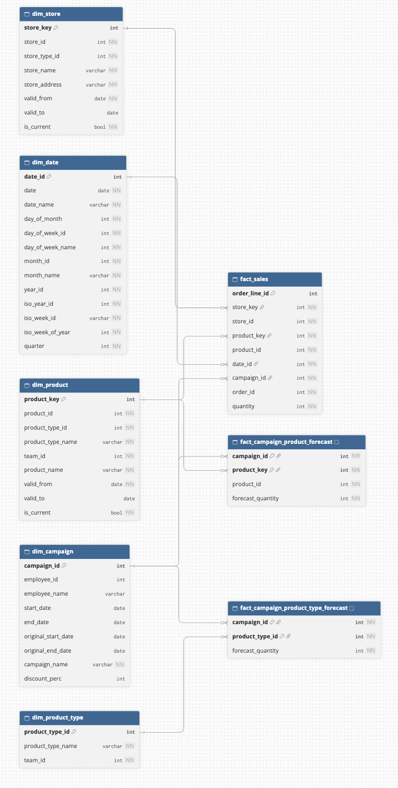

# Data model

Below is the proposed dimensional model to support the dashboard use cases: quantity sold, actual vs forecast performance, and top campaigns.

  

The model is a star schema with three fact tables and five dimensions. Sales and forecasts are kept in separate facts because they are recorded at different grains, and they are compared through the dimensions they share (campaign, product and product type).

## Use cases covered

| Use case | Answered by |
| --- | --- |
| Quantity sold by day, week, year | `fact_sales` + `dim_date` |
| Quantity sold by product and product type | `fact_sales` + `dim_product` (product type attributes are included in the product dimension) |
| Quantity sold by store | `fact_sales` + `dim_store` |
| Quantity sold by campaign and campaign manager | `fact_sales` + `dim_campaign` |
| Actual vs forecast performance | `fact_sales` compared with the two forecast facts, per campaign (and per product or product type within a campaign) |
| Top campaigns by quantity sold | `fact_sales` + `dim_campaign`, excluding the "No campaign" row |

## Facts

| Fact | Grain (one row per…) | Primary key | Measure |
| --- | --- | --- | --- |
| `fact_sales` | order line | `order_line_id` | `quantity` |
| `fact_campaign_product_forecast` | campaign and individually included product | `(campaign_id, product_id)` | `forecast_quantity` |
| `fact_campaign_product_type_forecast` | campaign and included product type | `(campaign_id, product_type_id)` | `forecast_quantity` |

- **`fact_sales`** is at the lowest grain available, so it can be aggregated to any level the dashboard needs. `order_id` is kept as a degenerate dimension (it has no attributes of its own), which allows counting orders.
- **Two forecast facts instead of one:** campaign managers include products either individually or by product type, so forecasts exist at two different grains. Combining them in one table would mix grains, and summing `forecast_quantity` would give misleading totals. Product type forecasts are also not split down to products, since that would require inventing an allocation rule the business never defined.
- **Additivity:** `quantity` is fully additive across all dimensions. `forecast_quantity` is additive across products and product types within a campaign, but it covers the whole campaign period: it has no date or store, so it can't be shown per day, week or store without an allocation.

## Dimensions

| Dimension | Grain (one row per…) | Key | Notes |
| --- | --- | --- | --- |
| `dim_date` | calendar day | `date_id` (`YYYYMMDD`) | Generated in dbt (2025–2027). Includes calendar month, quarter and year, and ISO weeks (Monday to Sunday) with their ISO year |
| `dim_store` | store version | `store_key` | Type 2 on address and store type |
| `dim_product` | product version | `product_key` | Type 2 on product type. Includes the product type name and team, so sales by product type need only one join |
| `dim_product_type` | product type | `product_type_id` | Rollup of `dim_product`, built from the same source so both always match. Used by the product type forecast fact |
| `dim_campaign` | campaign | `campaign_id` | Includes the campaign manager's name. Contains a "No campaign" row (`campaign_id = '-1'`) for sales outside any campaign |

Design choices:

- **Product type attributes are copied into `dim_product`** (in addition to `dim_product_type`). Grouping sales by product type is a core use case, so it shouldn't require joining two dimensions. `dim_product_type` still exists because the product type forecast fact needs its own dimension at that level.
- **The campaign manager is part of `dim_campaign`** instead of a separate dimension: a campaign has exactly one manager, and no fact table refers to managers directly.
- **"No campaign" row instead of NULL:** sales outside any campaign point to `campaign_id = '-1'`, so every sale has a valid campaign key, inner joins never drop sales, and the dashboard shows a readable "No campaign" label.

## How sales are linked to campaigns

A product belongs to at most one active campaign at any given time, so each sale belongs to zero or one campaign, and `campaign_id` is stored directly on `fact_sales`. The intermediate model `int_campaign_membership` resolves which products were part of which campaign, and when, including campaigns defined by product type.

## Bridge tables

No bridge table is needed. Bridges solve the case where one fact row relates to several values of a dimension. Here, the rule that a product belongs to at most one active campaign at a time guarantees that each sale relates to at most one campaign. The many-to-many relationship between campaigns and products is resolved once, in `int_campaign_membership`, when the model is built. A dbt test fails the build if the rule is ever broken in the source.

## SCD strategy

| Dimension | Attribute | Type | Reason |
| --- | --- | --- | --- |
| `dim_date` | all attributes | 0 | Generated; calendar facts are fixed by definition |
| `dim_store` | `store_name` | 1 | A rebranding is cosmetic; past sales show the current name |
| `dim_store` | `store_address`, `store_type_id` | 2 | Location and format affect sales; history stays continuous per store |
| `dim_product` | `product_name` | 1 | Renames are cosmetic; one consistent name across history |
| `dim_product` | `product_type_id` | 2 | Campaign membership and product type forecasts depend on the product type at the time of sale |
| `dim_product` | `product_type_name`, `team_id` | 1 | Follow `dim_product_type` |
| `dim_product_type` | `product_type_name`, `team_id` | 1 | The dashboard is for planning on the current portfolio; team accountability over time isn't required |
| `dim_campaign` | all attributes | 1 | Defined by the campaign manager; the current values are used |

History is captured with dbt snapshots of the source tables that only hold current state (`store`, `product`, `campaign_product`, `campaign_product_type`).

## Keys

- Identifiers are STRING; `date_id` is an INT64 in `YYYYMMDD` form.
- Type 2 dimensions use surrogate keys (`store_key`, `product_key`); Type 1 dimensions keep their natural keys.
- `fact_sales` carries both the surrogate and the natural keys of store and product.

## Actual vs forecast

Actuals and forecasts are never joined row by row, since that would repeat each forecast for every matching sale and inflate totals. Instead, each fact is aggregated separately to a shared level and then compared:

- **Per campaign:** sales of the campaign vs the sum of both forecast facts for that campaign.
- **Per product within a campaign:** for campaigns that include products individually.
- **Per product type within a campaign:** for campaigns that include whole product types.

Forecasts are compared at campaign level over the campaign's full period. A comparison by store, day or week isn't possible without an allocation rule, since forecasts are only defined per campaign.

## Assumptions

1. "At least two weeks" means `date_diff(end_date, start_date, day) >= 14`, with `end_date` the last day the campaign is active.
2. Discounts of 20–40% apply to real campaigns only; the "No campaign" row has no discount.
3. A product is in at most one active campaign on any day, and a campaign doesn't include the same product both individually and through its product type. Both rules are tested with severity `error`, so the build stops until the source is corrected.
4. Campaigns and forecasts are country-wide, so forecasts have no store.
5. Quantity is the only sales measure; there are no prices.
6. Only campaigns that have started are shown on the dashboard. Future campaigns stay in the model (with their forecasts) and are filtered out in the dashboard layer.
7. Orders are not updated, cancelled or returned after creation, and a product appears at most once per order.
8. Product IDs are shared between the Ordering System and the Campaign Management System.
9. Employees are never deleted from the Campaign Management System: `campaign.employee_id` is a foreign key to `campaign_manager`, so employees who leave are kept.
10. Actuals are compared against the latest forecast available for each campaign.

## Tests

- Source models test the incoming data: keys, relationships, and value ranges such as discounts and campaign length.
- Downstream models only test what their own logic could break, including the campaign rules (one active campaign per product, no double inclusion) with severity `error`.

## Possible extensions

- Dutch public holidays in `dim_date` (from a seed).
- A promotion coverage table, to answer which products were in a campaign but didn't sell.
- A progress column (share of the campaign elapsed) and a pacing indicator for running campaigns (forecast pro-rated to the days elapsed) in `campaign_performance`.
- The campaign manager as Type 2, if sales should be credited to the manager responsible at the time of each sale.
- A Type 3 `prior_team_id` on product types, if team accountability across reorganisations is needed.
- Store attributes such as size or last renovation date.
- A package size attribute on `dim_product`. `quantity` counts packages sold regardless of size (one 1kg bag and one 250g bag are both 1), so this would allow comparing sales in kilograms.
- One BigQuery dataset per layer (`raw`, `staging`, `snapshots`, `intermediate`, `core` for dimensions and facts, `reporting` for marts), configured with `+schema` per folder in dbt. Permissions in BigQuery are set per dataset, so dashboard users can be limited to the reporting layer, and the snapshots, which can't be rebuilt, are kept apart and protected.
- Separate environments: a `dev` target writing to personal datasets, and a `prod` target (ideally a separate GCP project) that only the scheduled Airflow run writes to.
