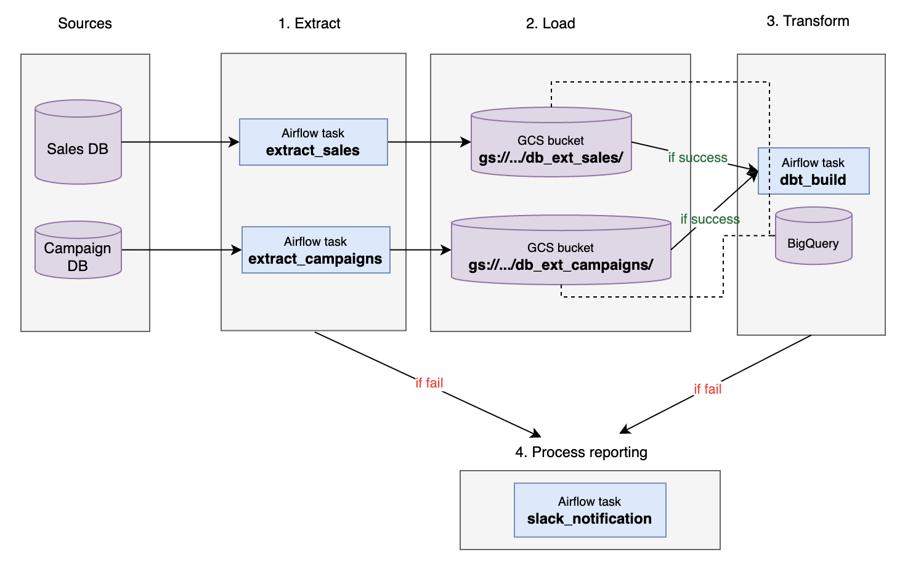

# Extraction pipeline

Below is the proposed diagram for integrating the source data into the data warehouse.

<p align="center">
  
</p>

The idea is to set up an Airflow pipeline, scheduled to run once a day shortly after midnight (00:30, Europe/Amsterdam), extracting the data of the previous day. It is composed of the following tasks:

1. **extract_sales**: queries all Ordering System tables and loads them into the GCS bucket.

2. **extract_campaigns**: queries all Campaign Management System tables and loads them into the GCS bucket.

   Each extraction is stored in its own folder per table, with the file name format `{table_name}_{date_id}.parquet`, where `date_id` is the extracted day (the day before the run). For example, the run of 28 October 2026 writes:

   ```
   gs://<bucket_name>/db_ext_sales/order/order_2026-10-27.parquet
   ```

   The two tasks above run in parallel. Only if both finish successfully is the next task triggered:

3. **dbt_build**: runs `dbt build`, which builds and tests all models defined in the project. For a deeper explanation of the modeling and dependencies, see [data_model.md](data_model.md).

4. **slack_notification**: for visibility, if any task fails, a Slack notification is sent with the pipeline metadata, so it's easy to jump in and debug.

## Extraction strategy per table

The extraction tasks don't treat every table the same way. Transactional tables (orders and order lines) only grow over time, so they are extracted incrementally. Reference tables (stores, products, product types, campaigns, campaign managers and campaign memberships) are small and describe the current state, so they are extracted in full:

| Table | System | Strategy | Extracted each run |
| --- | --- | --- | --- |
| `order` | Ordering System | Incremental | Orders with `order_date` equal to the previous day |
| `order_line` | Ordering System | Incremental | Order lines belonging to those orders (joined to `order`, since `order_line` has no date) |
| `store` | Ordering System | Full | The complete table |
| `product` | Ordering System | Full | The complete table |
| `product_type` | Ordering System | Full | The complete table |
| `campaign` | Campaign Management System | Full | The complete table |
| `campaign_manager` | Campaign Management System | Full | The complete table |
| `campaign_product` | Campaign Management System | Full | The complete table |
| `campaign_product_type` | Campaign Management System | Full | The complete table |

Downstream, the `src_` models read the files accordingly: for reference tables, only the latest extraction is used; for transactional tables, only the newly extracted day is processed and merged into the existing data (incremental models). The facts are still rebuilt in full on every run, so campaign and dimension version assignments always include the latest data.

## Comments

- The pipeline runs once a day because the finest date grain on the dashboard is a day. It runs shortly after midnight and extracts the previous day, so the day is complete for every store, including the webshop, whose orders can come in until midnight.
- Every row carries an `extract_date` column with the extracted day. Each source points to the whole folder of its table, and the `src_` models filter on `extract_date`, so each run only processes the day that was just extracted.
- Reruns overwrite the file for the same date, so a retried run doesn't create duplicates.
- Parquet is used as the file format, so column types and schema travel with the data.
- Since the pipeline runs daily, data accumulates quickly in the bucket. A GCS lifecycle rule can delete files older than an agreed period.
